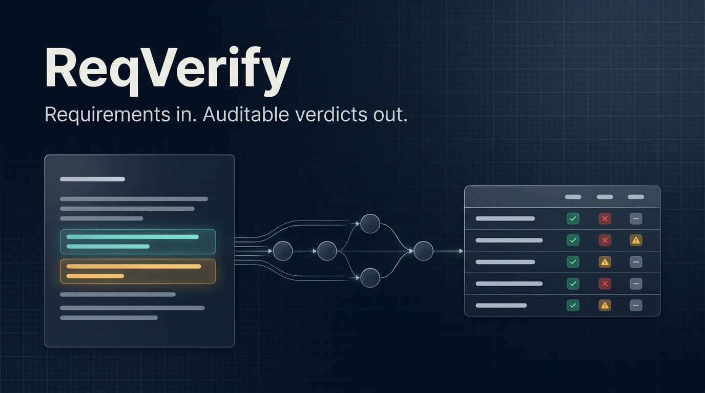
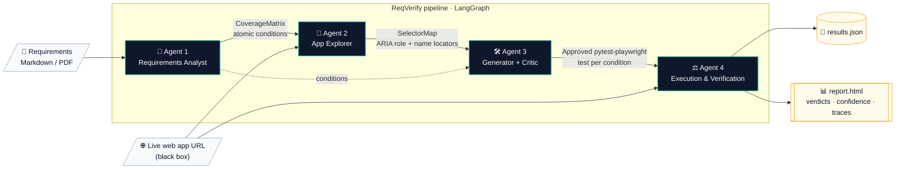
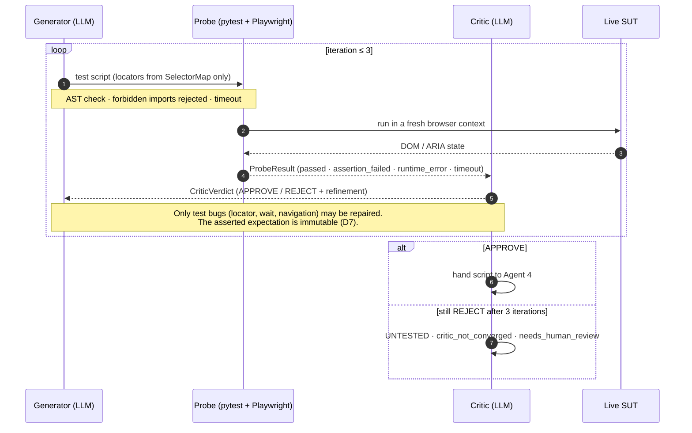
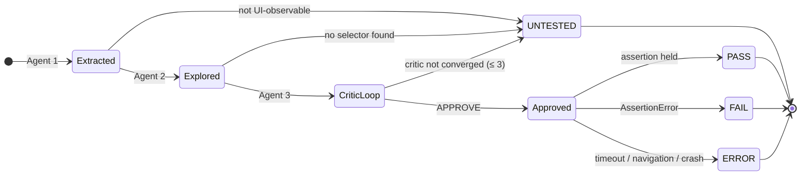
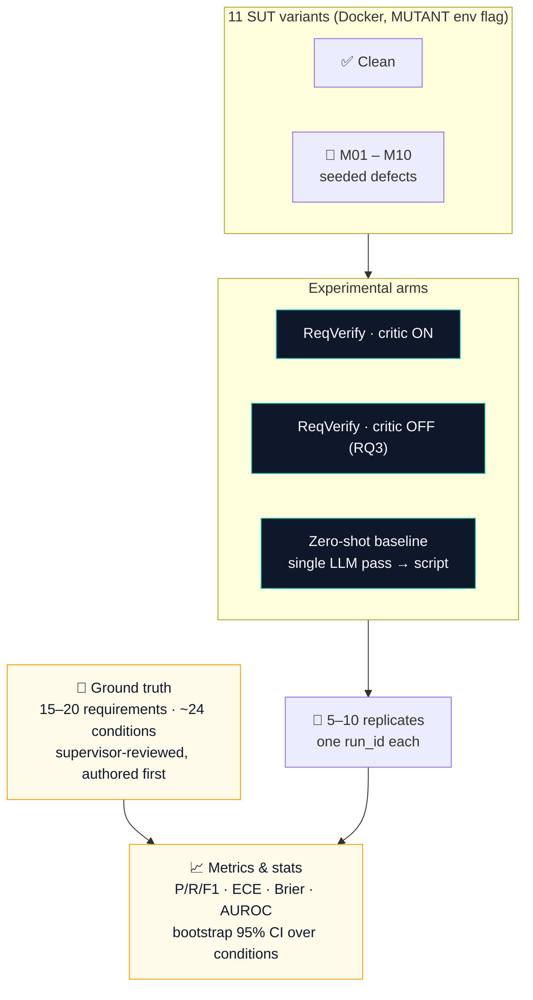
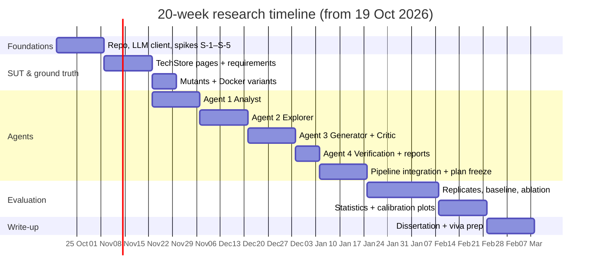

<div align="center">



# ReqVerify

**A Multi-Agent Explainable Requirements-Verification Framework for Web Applications**

[](#%EF%B8%8F-project-status--roadmap)
[](https://www.python.org/)
[](https://docs.langchain.com/oss/python/langgraph/graph-api)
[](https://playwright.dev/python/)
[](https://docs.pydantic.dev/)
[](https://platform.claude.com/docs/en/models/sonnet-5-5/overview)
[](https://nextjs.org/)

[What is it?](#-what-is-reqverify) ·
[Architecture](#%EF%B8%8F-how-does-it-work) ·
[Verdicts](#-what-does-a-verdict-mean) ·
[Research questions](#-research-questions) ·
[Evaluation](#-how-is-it-evaluated) ·
[Roadmap](#%EF%B8%8F-project-status--roadmap) ·
[FAQ](#-faq)

</div>

---

## 🔎 What is ReqVerify?

**ReqVerify is a black-box verification framework that turns plain-English software requirements into an auditable, requirement-by-requirement verification matrix for a live web application.** Four cooperating LLM agents, orchestrated with LangGraph, do the work in sequence:

1. Break each requirement into atomic, verifiable conditions.
2. Explore the running app through its ARIA accessibility snapshot.
3. Generate Playwright tests and repair them in a critic loop grounded in real execution.
4. Report each condition as `PASS`, `FAIL`, `ERROR` or `UNTESTED`, with a confidence score and a one-sentence justification.

> **Core axiom.** *A passing browser test is not proof of compliance.* A passing test only shows that a script ran without an unhandled error. ReqVerify makes the **verification matrix** the main output instead of the test scripts. Every verdict traces back to the exact sentence of the requirement it came from.

| | Conventional LLM test generators | **ReqVerify** |
|---|---|---|
| Primary deliverable | Executable test code / execution traces | **Per-condition verification matrix** |
| Traceability | Test ↔ feature (implicit) | **Verdict ↔ condition ↔ verbatim requirement span** (hashed ID) |
| Confidence | Not reported | **Per-verdict confidence, empirically calibrated** (ECE, Brier, AUROC) |
| Untestable clauses | Silently skipped | **Explicit `UNTESTED` class with a reason** |
| Self-repair | Optional / ungrounded | **Critic grounded in real Playwright execution, ≤ 3 iterations, assertions immutable** |

<sub>BEng (Hons) Computer Science Final Year Project · Informatics Institute of Technology (IIT) / University of Westminster · Author: **Induwara Yasas Jayakody** · Supervisor: **Mr. Asanjay Fernando** · README last updated **18 October 2026**.</sub>

---

## 🏗️ How does it work?

ReqVerify runs a **four-agent pipeline** behind a single pinned model (`claude-sonnet-5-5`). All agent outputs are typed with **Pydantic v2** contracts. The only window into the system under test (SUT) is a real browser, so the application is treated as an **opaque black box**.



| Agent | Input | Engine & grounding | Output contract |
|---|---|---|---|
| **1 · Requirements Analyst** | Requirements Markdown / PDF | Claude structured outputs (`messages.parse`), one call per `REQ-xx`, plus code-side post-processing | `CoverageMatrix`: atomic predicates, testability, confidence, verbatim `source_span` |
| **2 · App Explorer** | Base URL, credentials, `CoverageMatrix` | Playwright `page.aria_snapshot()` with a deterministic crawl and requirement-guided stateful flows | `SelectorMap`: ARIA role, accessible name, `get_by_role(...)` locator |
| **3 · Generator + Critic** | Conditions and selectors | Generator → sandboxed probe (`pytest` subprocess) → critic, as a LangGraph **subgraph per condition** | Approved Python `pytest-playwright` scripts |
| **4 · Execution & Verification** | Approved suite + live SUT | Fresh browser context per test; outcomes bound to `condition_id` | `RequirementVerificationResult[]` + JSON & HTML report |

### Inside Agent 3: an execution-grounded critic loop

LLMs struggle to self-correct reasoning *without external feedback* (Huang et al., ICLR 2024), but improve when given tool feedback (Gou et al., CRITIC, ICLR 2024). That is why the critic judges **real Playwright execution evidence**, not just the script text.



---

## 🚦 What does a verdict mean?

Every condition receives **exactly one of four statuses**. Statuses are derived from *execution evidence*, never from the LLM's opinion alone.



| Status | Meaning | Derived from |
|---|---|---|
| 🟢 `PASS` | A critic-approved script ran and its assertion held. | Probe `passed` + `APPROVE` |
| 🔴 `FAIL` | The script ran, selectors resolved, and the assertion did **not** hold. This is a likely application defect. | Probe `assertion_failed` (`AssertionError`) + `APPROVE` |
| 🟠 `ERROR` | The script could not complete (locator timeout, navigation error, crash). | Probe `runtime_error` or `timeout` |
| ⚪ `UNTESTED` | No valid test exists. It always carries a reason: `not_ui_observable`, `no_selector_found` or `critic_not_converged`. | Agents 1, 2 or 3 |

---

## 🧪 Research questions

| RQ | Question | Metrics | Target / hypothesis |
|---|---|---|---|
| **RQ1** | How accurately does Agent 1 extract atomic conditions from NL requirements? | Precision, Recall, F1 vs ground truth | H1: **Recall ≥ 0.80** |
| **RQ2** | Are the verbalized confidence scores of Claude Sonnet 5.5 calibrated? | ECE, Brier score, reliability diagram, AUROC | H2: confidence correlates with correctness. Miscalibration is reported as a finding. |
| **RQ3** | Does the execution-grounded critic improve test quality? | First-pass vs final pass rate, mapping accuracy, Δ with CI (Wilcoxon) | H3: positive Δ, critic ON vs OFF |
| **RQ4** | Can the full pipeline verify a live app **without source code**? | Accuracy, per-class P/R, **fault-detection recall** over 10 mutants, false-alarm rate, `UNTESTED` precision | End-to-end classification accuracy |

---

## 📐 How is it evaluated?

ReqVerify is evaluated as a **small-scale controlled evaluation**, not a case study (Runeson & Höst, 2009). The SUT is **TechStore**, a purpose-built 5-page Next.js 16 shop: Login, Product filtering, Cart with discount, Multi-step checkout and Admin order status. It ships with **10 seeded defect mutants**, so that a "100% pass on the clean app" cannot pass for success.



<details>
<summary><b>🐞 Seeded mutant registry (M01–M10)</b></summary>

| ID | Module | Seeded defect |
|---|---|---|
| M01 | Login | Email validation regex accepts `a@b` |
| M02 | Login | Minimum password length not enforced |
| M03 | Catalog | Price filter off-by-one (`<` instead of `≤`) |
| M04 | Catalog | "Out of stock" badge missing when stock = 0 |
| M05 | Cart | Line total ignores quantity |
| M06 | Cart | Discount applied inverted (adds instead of subtracts) |
| M07 | Checkout | Step 2 accepts an empty address |
| M08 | Checkout | Order total omits shipping |
| M09 | Admin | Status cannot be changed to "Shipped" |
| M10 | Cart | Cart not cleared after successful checkout |

The pipeline **never** sees mutant metadata or source (decision D6). The registry is the evaluation answer key only.
</details>

<details>
<summary><b>🔒 Validity safeguards</b></summary>

- **Dev/eval split (D13):** prompts are tuned only on a separate `dev_app`, never on TechStore's evaluation requirements.
- **Pre-registration (D12):** metric definitions, ECE bins, the `overall_confidence` formula and statistical tests are frozen in a dated `eval/analysis_plan.md` before the first evaluation run.
- **Assertion immutability (D7):** the critic may fix locators, waits and navigation, but may never weaken the expected outcome. Every diff is logged.
- **Reproducibility without `temperature`:** Sonnet 5.5 rejects sampling parameters, so reproducibility comes from a SQLite cache keyed by `run_id`, per-run manifests (model, effort, SDK versions, browser build, git commits, response IDs) and an archived cache.
- **Safe execution:** LLM-written code passes an AST check and a forbidden-import filter, then runs in a subprocess or container with a timeout and network access limited to the SUT.
</details>

---

## 🧰 Tech stack

| Layer | Choice | Why |
|---|---|---|
| LLM | **Claude Sonnet 5.5** (`claude-sonnet-5-5`), structured outputs | A single pinned model for all agents. Typed outputs via `messages.parse()`. |
| Orchestration | **LangGraph 1.2.x** | A bounded cyclic graph with an explicit iteration counter and a SQLite checkpointer for resumability. |
| Browser automation | **Playwright for Python ≥ 1.59** + `pytest-playwright` | `aria_snapshot()` exploration and role-based locators. Generated tests are Python only. |
| Contracts | **Pydantic v2** | Agent-boundary schemas, with client-side validation counted as a metric. |
| Reporting | **Jinja2** HTML + JSON | A human-readable audit report and a machine-readable result set. |
| Evaluation | numpy · pandas · scipy · scikit-learn · matplotlib | Metrics, bootstrap CIs, Wilcoxon tests, reliability diagrams. |
| SUT | **Next.js 16** (App Router, TypeScript) in Docker | One codebase, 11 switchable variants, deterministic seed. |

---

## 📁 Repository layout

> [!NOTE]
> The project is moving from **planning to implementation**. The tree below is the **target layout** from the implementation guide. Folders appear as each phase lands.

```text
reqverify/
├─ pyproject.toml · requirements.lock · .env.example · README.md
├─ src/reqverify/
│  ├─ llm/            client.py (parse + SQLite cache + manifest), prompts/
│  ├─ schemas/        contracts.py
│  ├─ agents/         analyst.py · explorer.py · generator.py · critic.py · probe.py · verifier.py
│  ├─ graph/          agent3_subgraph.py · pipeline.py
│  ├─ reporting/      json_report.py · html_report.py · templates/report.html.j2
│  └─ cli.py
├─ techstore/         Next.js 16 SUT · mutants/registry.yaml · Dockerfile · docker-compose.yml
├─ eval/              ground_truth/ · analysis_plan.md · run_eval.py · metrics.py · stats.py · baselines/
├─ dev_app/           tiny separate app for prompt development (D13)
├─ runs/              <run_id>/ manifest.json · results.json · report.html · traces/
├─ docs/              decision-log.md · appendix_L_genai_log.md · assets/
├─ planning/          phase-by-phase implementation plans + master_plan.md
└─ tests/             unit + integration tests (recorded LLM fixtures) · live smoke tests
```

---

## 🚀 Getting started

> [!IMPORTANT]
> The commands below describe the **intended developer setup** (Windows PowerShell shown). The `reqverify` CLI becomes available once Phase 08 is complete.

**Prerequisites:** Python 3.11+, Node.js ≥ 20.9 (LTS), Docker, git, and an Anthropic API key.

```powershell
git clone https://github.com/Woofy2001/reqverify.git
cd reqverify

python -m venv .venv
.venv\Scripts\activate
pip install -e .
playwright install chromium

Copy-Item .env.example .env   # then set ANTHROPIC_API_KEY and REQVERIFY_MODEL=claude-sonnet-5-5
```

```powershell
# Verify a running app against a requirements document
reqverify run --requirements eval/ground_truth/requirements.md --url http://localhost:3000

# Test suite: recorded fixtures by default, live API smoke tests only when a key is set
pytest -m "not live"
pytest -m live
```

---

## 🗺️ Project status & roadmap

Implementation follows 11 dependency-ordered phases. Each phase has an entry gate, an exit gate and its own test suite that must be fully green before the next phase starts.

```mermaid
flowchart LR
    P0["00<br/>Setup &<br/>spikes"] --> P1["01<br/>LLM layer"]
    P1 --> P2["02<br/>TechStore<br/>+ dev app"]
    P2 --> P3["03<br/>Ground truth<br/>+ mutants"]
    P3 --> P4["04<br/>Agent 1<br/>Analyst"]
    P4 --> P5["05<br/>Agent 2<br/>Explorer"]
    P5 --> P6["06<br/>Agent 3<br/>Gen + Critic"]
    P6 --> P7["07<br/>Agent 4<br/>+ reports"]
    P7 --> P8["08<br/>Pipeline<br/>+ CLI"]
    P8 --> P9["09<br/>Evaluation<br/>harness"]
    P9 -.-> P10["10<br/>Stretch<br/>(optional)"]

    classDef done fill:#14b8a6,stroke:#0f766e,color:#ffffff;
    classDef todo fill:#0f172a,stroke:#14b8a6,color:#f8fafc;
    classDef opt fill:#f8fafc,stroke:#94a3b8,color:#334155,stroke-dasharray: 4 3;
    class P0,P1,P2,P3,P4,P5,P6,P7,P8,P9 todo;
    class P10 opt;
```





---

## ❓ FAQ

**How is ReqVerify different from WebTestPilot?**
WebTestPilot (Teoh et al., FSE 2026) infers pre/post-condition oracles over GUI elements for natural-language requirements and evaluates them on bug-injected apps. ReqVerify's contribution has four parts:
- a per-condition, auditable verification matrix;
- confidence that is measured for calibration rather than assumed;
- an ablation of the execution-grounded critic;
- an explicit `UNTESTED` class.

ReqVerify does not claim to find more raw bugs.

**Can the confidence scores be trusted?**
Not by assumption. Earlier models have been reported to be overconfident when they state their own confidence (Xiong et al., ICLR 2024). ReqVerify measures ECE, Brier score and AUROC for Claude Sonnet 5.5 and reports any miscalibration as a finding (RQ2).

**Why is the model `claude-sonnet-5-5` and not Claude Sonnet 4?**
The original blueprint's `claude-sonnet-4-20250514` was retired on 15 June 2026. ReqVerify uses the vendor's recommended replacement, pins the model ID, and archives all inputs and outputs.

**Does it need the application's source code?**
No. Agents interact with the app only through a real browser and its accessibility tree. Mutant source and metadata are deliberately hidden from the pipeline.

**Why does a single self-built app not invalidate the results?**
It limits external generalizability, and the dissertation states this openly (Baltes & Ralph, 2022). In exchange, it gives high internal validity: controlled variants, 10 seeded mutants, a frozen analysis plan and multiple replicates with bootstrap CIs.

---

## 📚 Key references

- Teoh et al., *WebTestPilot*, Proc. ACM Softw. Eng. 3(FSE), 2026. [arXiv:2602.11724](https://arxiv.org/abs/2602.11724)
- Alian et al., *AutoE2E: Feature-Driven End-to-End Test Generation*, ICSE 2025. [arXiv:2408.01894](https://arxiv.org/abs/2408.01894)
- Kong et al., *WebTestBench*, 2026. [arXiv:2603.25226](https://arxiv.org/abs/2603.25226)
- Huang et al., *Large Language Models Cannot Self-Correct Reasoning Yet*, ICLR 2024. [arXiv:2310.01798](https://arxiv.org/abs/2310.01798)
- Gou et al., *CRITIC*, ICLR 2024. [arXiv:2305.11738](https://arxiv.org/abs/2305.11738)
- Xiong et al., *Can LLMs Express Their Uncertainty?*, ICLR 2024. [arXiv:2306.13063](https://arxiv.org/abs/2306.13063)
- He, Treude & Lo, *LLM-Based Multi-Agent Systems for Software Engineering*, ACM TOSEM 2025. [arXiv:2404.04834](https://arxiv.org/abs/2404.04834)
- Fuchß et al., *Beyond Retrieval: LLM Ensembles for Candidate Filtering in Requirements Traceability*, IEEE REW 2025. DOI [10.1109/REW66121.2025.00006](https://doi.org/10.1109/REW66121.2025.00006)
- Ali, Naganathan & Bork, *Establishing Traceability … by Combining RAG and LLMs*, ER 2024 (Springer). [Link](https://link.springer.com/chapter/10.1007/978-3-031-75872-0_16)
- Runeson & Höst, *Guidelines for conducting and reporting case study research in SE*, EMSE 14(2), 2009. DOI [10.1007/s10664-008-9102-8](https://doi.org/10.1007/s10664-008-9102-8)
- Baltes & Ralph, *Sampling in Software Engineering Research*, EMSE 2022. [arXiv:2002.07764](https://arxiv.org/abs/2002.07764)

---

## 📝 Citation

```bibtex
@misc{jayakody2027reqverify,
  author       = {Jayakody, Induwara Yasas},
  title        = {ReqVerify: A Multi-Agent Explainable Requirements-Verification Framework for Web Applications},
  year         = {2027},
  howpublished = {BEng (Hons) Computer Science Final Year Project, Informatics Institute of Technology / University of Westminster},
  note         = {Supervisor: Asanjay Fernando. \url{https://github.com/Woofy2001/reqverify}}
}
```

<div align="center">
<sub>Built as an academic research project · Generative-AI use during development is logged in <code>docs/appendix_L_genai_log.md</code>.</sub>
</div>
