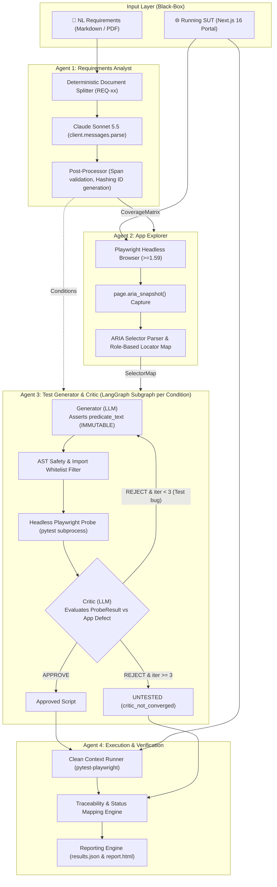

# ReqVerify: Deep-Dive Research & Architectural Brief

**Candidate:** Induwara Yasas Jayakody (w2052261 / 20230744)  
**Academic Supervisor:** Mr. Asanjay Fernando  
**Institution:** Informatics Institute of Technology (IIT) / University of Westminster  
**Degree Program:** BEng (Hons) in Computer Science (Final Year Project)  
**Authoritative Reference:** `implementation-guide.md` (takes precedence over original Blueprint PDF)

---

## 1. Problem Statement & Theoretical Paradigm Shift

### The Problem
In contemporary software engineering and quality assurance (QA), translating natural language (NL) requirements into browser automated end-to-end (E2E) test suites is predominantly manual, fragile, and labor-intensive. Existing automated testing research (e.g., AutoE2E, WebTestPilot) focuses almost exclusively on generating executable test scripts or capturing execution traces to find crashes.

### The Core Axiom
> **"A passing browser test script is not proof of compliance."**
> A green test run only proves that an automated sequence completed without throwing an unhandled runtime error. It does not prove that every clause, edge case, and business constraint specified in the requirements document actually holds true in the live software.

### The ReqVerify Paradigm Shift
ReqVerify shifts the **primary deliverable** from test scripts to an **auditable, requirement-by-requirement verification matrix**. Every atomic requirement clause is classified deterministically as:
- `PASS` (Assertion held on a critic-approved test)
- `FAIL` (Assertion legitimately failed on a critic-approved test — application defect)
- `ERROR` (Script could not complete — timeout, locator failure, crash)
- `UNTESTED` (Explicitly unverified with an auditable reason: non-UI-observable, no selector found, or critic non-convergence)

Every verdict is backed by an auditable trace connecting back to the verbatim source text span, accompanied by an empirically calibrated confidence score and natural-language rationales enforced at every agent boundary.

---

## 2. Research Questions, Hypotheses & Evaluation Metrics

| RQ | Research Question | Hypothesis & Variables | Target Metrics & Threshold |
| :--- | :--- | :--- | :--- |
| **RQ1** | How accurately does Agent 1 decompose NL requirements into atomic verifiable conditions? | **H1:** Extraction achieves **Recall $\ge$ 0.80** compared to human expert ground truth. • *IV:* Agent 1 prompt/model pipeline vs ground truth. • *DV:* Extracted atomic predicates. | Precision, Recall, F1-Score. **Threshold: Recall $\ge$ 0.80** (fixed consistently as $\ge$). Evaluated with inter-rater matching protocol. |
| **RQ2** | Are the verbalized confidence scores generated by Claude Sonnet 5.5 well-calibrated against empirical correctness? | **H2:** Confidence scores positively correlate with verification correctness; miscalibration reflects verbalized overconfidence reported in literature (Xiong et al., 2024). • *IV:* Agent confidence scores. • *DV:* Empirical correctness (verdict matches ground truth). | Expected Calibration Error (ECE, 5–10 bins), Brier score, Reliability Curves, AUROC. |
| **RQ3** | Does the live execution-grounded critic loop yield a statistically significant improvement in test quality and pass rate? | **H3:** Execution-grounded critic repairs test-code bugs (locators, waits, navigation) without altering asserted business logic, yielding positive pass-rate $\Delta$. • *IV:* Pipeline with Critic (ON) vs without Critic (OFF). • *DV:* First-pass vs final test pass rate, condition mapping accuracy. | Pass Rate Delta ($\Delta\%$), Mapping Accuracy Delta ($\Delta\%$), paired Wilcoxon signed-rank test with 95% CIs. |
| **RQ4** | Can the multi-agent pipeline verify a live application without source code access while distinguishing genuine defects from test bugs? | **H4:** ReqVerify achieves high Fault Detection Recall over seeded mutants and low false-alarm rate on clean app. • *IV:* Full pipeline run on clean app + 10 seeded mutants. • *DV:* Accuracy of verdict classification. | Fault Detection Recall (mutants detected / 10), False Alarm Rate on clean app, Precision on `UNTESTED` class. |

---

## 3. Honest Academic Positioning vs State of the Art

To eliminate senior lecturer viva traps, ReqVerify is positioned precisely and honestly:

1. **vs. WebTestPilot (Teoh et al., ACM FSE 2026 / arXiv:2602.11724):**
   - *What WebTestPilot does:* Decomposes natural language requirements into condition-action-expectation tuples and infers pre/post-condition GUI oracles over symbolized DOM elements, evaluated on bug-injected apps.
   - *ReqVerify's distinctive contribution:* ReqVerify does not claim to find more raw crashes. ReqVerify produces an **auditable per-condition verification matrix**, measures and plots **empirical confidence calibration (ECE/Brier)** on frontier models (Claude Sonnet 5.5), isolates the **tool-grounded critic ablation (RQ3)**, and features an **explicit `UNTESTED` status** with reasons for non-testable clauses.
2. **vs. AutoE2E (Alian et al., ICSE 2025 / arXiv:2408.01894):**
   - *Distinction:* AutoE2E focuses on DOM and feature coverage through autonomous exploratory crawling; ReqVerify focuses on *verifying explicit business compliance specifications* against an opaque black-box web app.
3. **vs. WebTestBench (Kong et al., arXiv:2603.25226):**
   - *Distinction:* WebTestBench provides an empirical benchmark isolating checklist generation bottlenecks; ReqVerify provides an end-to-end multi-agent verification system with closed-loop execution repair.
4. **Methodological Labeling (Runeson & Höst, 2009; Baltes & Ralph, 2022):**
   - ReqVerify is strictly declared as a **"small-scale controlled empirical evaluation"**, *not* an industrial case study. This acknowledges the external generalizability limitation while maximizing internal validity through controlled variants and seeded defect mutants.

---

## 4. Multi-Agent Pipeline Architecture & Topology

---

## 5. Summary of Blueprint Corrections & Non-Negotiable Invariants

| # | Item | Blueprint Flaw | Authoritative Correction in `implementation-guide.md` |
|---|---|---|---|
| 1 | **LLM Model (D1)** | `claude-sonnet-4-20250514` (retired June 15, 2026) | Pin **`claude-sonnet-5-5`**. Active, 1M context, 128K max output. |
| 2 | **Sampling Parameters** | `temperature=0.0` (raises HTTP 400 on Sonnet 5.5) | **Omit `temperature`, `top_p`, `top_k`, and prefill entirely.** Reproducibility is guaranteed via SQLite cache, run manifests, and fixed `run_id` seeds. |
| 3 | **DOM Extraction (D2)** | `page.accessibility` (removed in Playwright 1.57) | Use **`page.aria_snapshot()`** (supported in Playwright $\ge 1.59$, currently stable 1.63). |
| 4 | **Test Runner (D2)** | Node Playwright & TypeScript | **Generate Python `pytest-playwright` only.** One unified toolchain and JSON reporter plugin. |
| 5 | **Schema Enforcement** | Assumed Pydantic constraints enforced by Anthropic API | Use `client.messages.parse()`. Numeric/length constraints are client-side checks; count failures as metrics. |
| 6 | **Prompt Phrasing** | Schema asked for "step-by-step reasoning" | Phrased as a *one-sentence justification* to prevent `reasoning_extraction` refusals. |
| 7 | **Status Semantics (D3)** | Mismatched 3 vs 4 statuses | Exactly 4 statuses: **`PASS`**, **`FAIL`**, **`ERROR`**, **`UNTESTED`**. |
| 8 | **Condition IDs (D4)** | Hashing LLM paraphrased text | Generated programmatically in code: `make_condition_id(req_id, source_span, ordinal)`. |
| 9 | **Cache Replicates (D5)**| Global SQLite cache without run seed | Cache key includes `run_id`. Dev uses `"dev"`, evaluation replicates use distinct `run_id`s. |
| 10 | **Black-Box Isolation (D6)**| Mutant metadata leak risk | Mutant registry (`registry.yaml`) is strictly excluded from pipeline reach. |
| 11 | **Assertion Immutability (D7)**| Critic repairing assertions to pass against bugs | **Critic and Generator may NEVER alter the asserted business expectation.** Locators and waits only. Diffs logged. |
| 12 | **LangGraph Topology (D8)**| Monolithic graph hitting recursion limit | Agent 3 is compiled as a **subgraph executed once per condition** with an explicit iteration counter capped at 3. |
| 13 | **SUT Stack (D9)** | Unversioned Next.js | **Next.js 16 (LTS)** App Router with TypeScript and deterministic database seeding. |
| 14 | **Analysis Pre-Registration (D12)**| Post-hoc threshold tuning | Analysis plan (`eval/analysis_plan.md`) frozen before first evaluation run. |
| 15 | **Dev / Eval Split (D13)**| Overfitting prompts to test requirements | Prompts tuned solely on separate `dev_app` and dev requirements; evaluation requirements remain untouched. |

---

## 6. SUT, Ground Truth & Seeded Defect Mutants

### TechStore SUT Scope
1. **Login Page:** Authentication with validation.
2. **Product Catalog & Filtering:** Dynamic category/price filtering, stock badges.
3. **Cart & Promotion:** Quantity adjustment, line totals, coupon code discount.
4. **Multi-Step Checkout:** Shipping info, address validation, order review.
5. **Admin Order Portal:** Status update tracking.

### 10 Seeded Defect Mutants (`techstore/mutants/registry.yaml`)
- `M01` (Login): Email validation regex accepts invalid format `a@b`.
- `M02` (Login): Minimum password length constraint omitted.
- `M03` (Catalog): Price filter off-by-one error ($<$ instead of $\le$).
- `M04` (Catalog): Out-of-stock badge missing when stock is 0.
- `M05` (Cart): Line total ignores item quantity.
- `M06` (Cart): Discount coupon adds rather than subtracts discount.
- `M07` (Checkout): Step 2 accepts empty shipping address.
- `M08` (Checkout): Order final total omits shipping cost.
- `M09` (Admin): Status transition to "Shipped" fails to persist.
- `M10` (Cart): Cart fails to clear following completed checkout.

---

## 7. Risk Register & Mitigations Summary

| Risk ID | Identified Risk | Impact | Mitigation Strategy |
|---|---|---|---|
| **R-01** | Sonnet 5.5 API cost overrun during multi-replicate runs | High | SQLite caching, dev/eval split, token budget guard in CLI, 5 replicates first (Protocol P-B). |
| **R-02** | Critic test-fitting fallacy (weakening assertions to pass against bugs) | Critical | Invariant D7: Assertions derived from `predicate_text` are immutable. Every test diff is logged and inspected. |
| **R-03** | Prompt overfitting to evaluation requirements | High | Invariant D13: Prompts tuned solely on `dev_app` before freeze. |
| **R-04** | LangGraph recursion explosion on looping | High | Invariant D8: Isolated subgraph per condition, hardcoded iteration counter $\le 3$, recursion_limit = 25. |
| **R-05** | Flaky browser tests causing spurious failures | Medium | Role-based ARIA locators via `aria_snapshot`, auto-waiting, dedicated Docker containers with network isolation. |
| **R-06** | Execution of LLM-generated Python scripts | High | Python AST parsing, forbidden import whitelist (`os`, `subprocess`, `socket` blocked), execution timeout (60s). |
| **R-07** | Model drift and deprecation | Medium | Pinned model string `claude-sonnet-5-5`, response IDs logged in manifest, complete frozen SQLite cache archive. |

---

## 8. Resolution of Unverified Items (⚠️) in Phase Roadmap

- **Spike S-1 (Phase 00):** Verify whether `client.messages.parse(output_format=Model)` accepts `output_config={"effort": "high"}` or requires fallback to `messages.create()`.
- **Spike S-2 (Phase 00):** Real YAML-like text parsing of Playwright `page.aria_snapshot()`.
- **Spike S-3 (Phase 00):** LangGraph conditional cycle with stubs terminating at iteration 3.
- **Spike S-4 (Phase 00):** Distinction between `AssertionError` (`FAIL`) and `TimeoutError` (`ERROR`) in pytest.
- **Spike S-5 (Phase 00):** Cache hit replay vs fresh execution using distinct `run_id`s.
- **LangGraph SQLite Saver (Phase 00):** Confirm exact package name (`langgraph-checkpoint-sqlite`) and import path via context7.
- **Playwright Docker Image (Phase 03):** Verify exact pinned tag on `mcr.microsoft.com/playwright/python`.
- **WebTestPilot Public Repository (Phase 10):** Verify license and feasibility for external baseline comparison.
