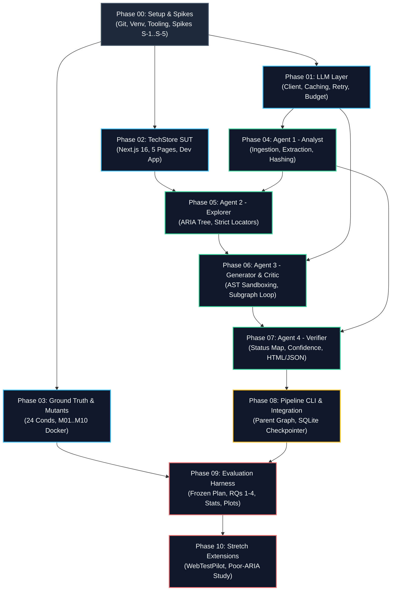

# ReqVerify: Master Implementation Plan

> **MANDATORY READING PROTOCOL FOR AGENTS & IMPLEMENTERS:**  
> Before implementing any phase or executing commands from these plans, you **MUST READ EVERY LINE UNTIL THE END OF THE FILE**. Do NOT truncate, skim, or hallucinate content. Use `view_file` with explicit line ranges (`StartLine`/`EndLine`) or `ContentOffset` to read long planning files completely across multiple pages until the tool confirms the file is complete.  
> Every phase plan in `planning/phase-XX-*/PLAN.md` is an authoritative contract. Follow its tasks, schemas, test specifications, and verification commands with zero drift.

---

## 1. Executive Summary & Architecture Roadmap

ReqVerify is a **Multi-Agent Explainable Requirements-Verification Framework for Web Applications** developed for BEng Final Year Research at First-Class (A*) standard. It ingests natural-language requirements documents, autonomously explores live web applications, synthesizes deterministic Playwright test scripts, repairs test defects through a sandboxed Generator-Critic loop, and produces auditable, calibrated verification verdicts with complete execution provenance.



---

## 2. Non-Negotiable Technical Invariants

The following 13 invariants govern all code, schemas, prompts, and evaluation pipelines across all phases. They are mandatory and immutable:

1. **Model Specification (D1):** Use `claude-sonnet-5-5`. Never pass `temperature`, `top_p`, `top_k`, assistant prefill, forced `tool_choice`, or `thinking: {type: "disabled"}` (all raise HTTP 400). Set `max_tokens` explicitly (default 16,000). Record effort level in every run manifest.
2. **Structured Outputs (D1, §6):** All structured LLM calls MUST pass through `client.messages.parse(..., output_format=Model)`. Numerical and regex constraints are client-side Pydantic validations. Record all schema validation failures. Compare string enum outputs case-insensitively. Safely intercept `stop_reason` of `refusal` and `max_tokens`.
3. **Prompt Rationale Discipline (§1 item 6):** Rationale prompt instructions MUST ask for a *"one-sentence justification"*. Never request *"step-by-step reasoning"* or *"chain of thought"* in prompts, preventing policy refusals and token blowouts.
4. **Canonical Status Semantics (D3, §7.3):** Every condition verdict MUST resolve to exactly one of 4 statuses:
   - `PASS`: Probe passed assertion and Critic approved.
   - `FAIL`: Probe failed assertion (`AssertionError`) and Critic approved as legitimate defect.
   - `ERROR`: Probe aborted due to timeout, navigation crash, or unhandled exception.
   - `UNTESTED`: No valid test exists; **ALWAYS** carries an explicit `untested_reason` (`not_ui_observable`, `no_selector_found`, or `critic_not_converged`).
5. **Deterministic Condition IDs (D4, §7.1):** Condition IDs MUST be generated in code using SHA-256 via `make_condition_id(req_id, source_span, ordinal)`. Never allow the LLM to generate or paraphrase IDs.
6. **Execution Provenance & `run_id` (D5):** Every pipeline execution MUST generate a unique UUIDv4 `run_id`. This ID prefixes log files, SQLite checkpointer threads, cache keys, report directories, and Playwright trace archives.
7. **Mutant & Ground Truth Isolation (D6):** The mutant registry (`techstore/mutants/registry.yaml`) and ground truth answer keys MUST remain strictly inaccessible to the agent pipeline. Evaluation scripts read ground truth; pipeline agents never see it.
8. **Assertion Immutability (D7):** Test assertions derived from `predicate_text` are immutable across all iterations. The Generator and Critic may repair locators, waits, and navigation actions, but **MUST NEVER modify or weaken the asserted expectation**.
9. **Agent 3 Subgraph & Loop Bounding (D8):** Agent 3 is an isolated LangGraph subgraph invoked once per condition. The repair loop is capped at **exactly 3 iterations**. If unapproved after 3 iterations, the condition terminates as `UNTESTED` (`critic_not_converged`, `needs_human_review=True`).
10. **SQLite Checkpointer Threading (D8, §10):** Graph state persistence uses `langgraph.checkpoint.sqlite.SqliteSaver` keyed strictly by `thread_id = f"{run_id}:{condition_id}"`.
11. **Evaluation Protocols (D11):** Primary evaluation protocol is **Protocol P-B** (each mutant evaluated in its own isolated Docker container with fresh database seed). Protocol P-A (multi-tenant shared container) is secondary. Baseline is the Zero-Shot LLM classifier (D10a).
12. **Analysis Plan Pre-Registration (D12):** `eval/analysis_plan.md` MUST be frozen and committed to git **before** executing benchmark evaluation runs. No metric formulas or hypotheses may be altered post-hoc.
13. **Prompt Tuning Isolation (D13):** Prompts, few-shot examples, and heuristic thresholds MUST be tuned exclusively on `dev_app` and its development requirements. Never tune prompts against TechStore evaluation requirements.

---

## 3. Master Phase Index & Gate Summary

| Phase | Title | Entry Gate | Exit Gate & Verification | Key Deliverable |
|---|---|---|---|---|
| **Phase 00** | Setup, Tooling & Spikes | Clean workspace, Python 3.11, Node v22 | S-1 to S-5 spikes verified, repo initialized | `pyproject.toml`, Git repo, Spikes S1–S5 |
| **Phase 01** | LLM Client & Caching Layer | Phase 00 complete | 100% offline tests pass, cache & budget verified | `LLMClient`, `FakeLLMClient`, SQLite cache |
| **Phase 02** | TechStore SUT & Dev App | Phase 00 complete | 5 pages active, seeded users, ARIA audit | TechStore Next.js app, Docker, `dev_app` |
| **Phase 03** | Ground Truth & Mutants | Phase 02 running | 24 conds, 10 Docker mutant tags built | `conditions.csv`, `mutants/registry.yaml` |
| **Phase 04** | Agent 1: Requirements Analyst | Phase 01 + Dev requirements | Extraction Recall $\ge 0.80$ on dev set | `RequirementsAnalystAgent`, postprocessor |
| **Phase 05** | Agent 2: App Explorer | Phase 02 + Phase 04 | ARIA snapshot parser verified, locators strict | `AppExplorerAgent`, `AriaSnapshotParser` |
| **Phase 06** | Agent 3: Generator & Critic | Phase 01 + Phase 04 + Phase 05 | AST safety verified, subgraph loop bounded at 3 | `build_agent3()` subgraph, AST validator |
| **Phase 07** | Agent 4: Verifier & Reports | Phase 06 complete | Statuses match §7.3, confidence frozen, HTML OK | `derive_status`, Jinja2 HTML/JSON reports |
| **Phase 08** | Pipeline CLI & Integration | Phase 04–07 complete | Clean TechStore run produces 0 false alarms | `reqverify run` CLI, Parent LangGraph |
| **Phase 09** | Evaluation Harness & Stats | Phase 03 + Phase 08 + Frozen Plan | RQs 1–4 computed, bootstrap 95% CIs, charts | `eval/run_eval.py`, `eval/analysis_plan.md` |
| **Phase 10** | Stretch Goals & Extensions | Phase 09 complete | Feasibility report, poor-ARIA study notes | WebTestPilot audit, Poor-ARIA study |

---

## 4. MCP Tools & Skills Integration Matrix

During implementation, agents and developers must invoke specialized tools and skills at designated steps to guarantee Senior Staff Engineering rigor:

| Domain / Step | Primary MCP Server | Skill Protocol | Specific Action / Verification |
|---|---|---|---|
| **API & Library Best Practices** | `context7` | `using-superpowers` | Query official docs for Pydantic v2, LangGraph `StateGraph`, Playwright `page.aria_snapshot()`. |
| **Browser & UI Verification** | `playwright` | `emil-design-eng` / `impeccable` | Launch headless browser to inspect TechStore ARIA snapshots and verify generated HTML reports. |
| **Docker Container Builds** | `docker-hub` | `systematic-debugging` | Manage mutant image builds, inspect layer provenance, and monitor container execution. |
| **Sequential Logic & Reasoning** | `sequential-thinking` | `brainstorming` | Reason through complex multi-agent state edge cases, router cycles, and error recovery paths. |
| **Feature Implementation** | N/A | `test-driven-development` | Write failing tests first (`RED`), implement clean code (`GREEN`), refactor without regressions (`REFACTOR`). |
| **Task Completion Claim** | N/A | `verification-before-completion` | Run verification commands and inspect exit codes before claiming any task or phase is complete. |

---

## 5. Strict Implementation Gate Loop

To prevent cascading regressions and maintain zero-defect standards throughout implementation, adhere to the following protocol for **every phase**:

```
[Phase Entry Gate Verified]
           │
           ▼
[Step N: Write Failing Test First (RED)]
           │
           ▼
[Step N: Implement Production Code (GREEN)]
           │
           ▼
[Step N: Run Pytest / Playwright Verification Command]
      ┌────┴────┐
    Fail       Pass
      │         │
      ▼         ▼
[Debug / Fix]  [Next Step / Phase Exit Gate]
```

### Invariant Rules for Implementation:
1. **Never Advance with Failing Tests:** If a test fails, invoke `systematic-debugging`, identify root cause, fix the implementation, and re-run. Never comment out tests or bypass assertions.
2. **Offline-First Development:** Unit tests and routine integration tests MUST use pre-recorded fixtures and `FakeLLMClient`. Do not hit the live Anthropic API during iterative coding.
3. **One Live Smoke Gate Per Phase:** Execute live Claude API tests (`@pytest.mark.live`) exactly once at the phase exit gate to confirm real API wire compatibility.
4. **No Build Policy:** Do not run full project builds (`npm run build`) after minor edits. Rely on unit tests and dev servers.

---

## 6. Human-Only Decision & Authorization Gates

The following gates require explicit human intervention and cannot be performed autonomously by AI agents:

1. **Gate H-1: Requirements & Ground Truth Sign-Off (Phase 03)**  
   - Academic supervisor or senior peer must review `eval/ground_truth/requirements.md` and `conditions.csv` to ensure academic validity and fair mutant representation.
2. **Gate H-2: Second-Reviewer Semantic Matching (Phase 03 / Phase 09)**  
   - An independent second reviewer must evaluate a sample of extracted conditions against the ground truth answer key to calculate Cohen's Kappa / inter-annotator agreement for RQ1.
3. **Gate H-3: Live API Key Provisioning & Budget Spend Limit (Phase 01 / Phase 08)**  
   - The user must provide the `ANTHROPIC_API_KEY` in the local `.env` and set a strict spending cap (e.g., $15–$25) on the Anthropic Console before benchmark runs.
4. **Gate H-4: Pre-Registration Analysis Plan Freezing (Phase 09)**  
   - The user must inspect `eval/analysis_plan.md` and explicitly confirm its pre-registration status before executing benchmark scripts on mutant containers.
